<p align="center">
  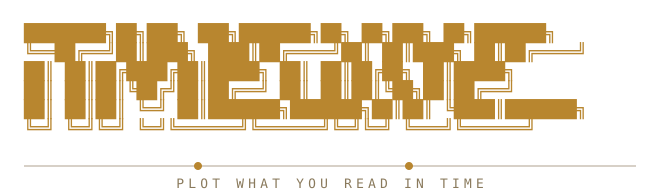
</p>

<p align="center">
  <b>Author:</b> Regan O'Donnell &nbsp;·&nbsp; <b>Released:</b> November 16, 2026 &nbsp;·&nbsp; <b>License:</b> MIT
</p>

<p align="center">
  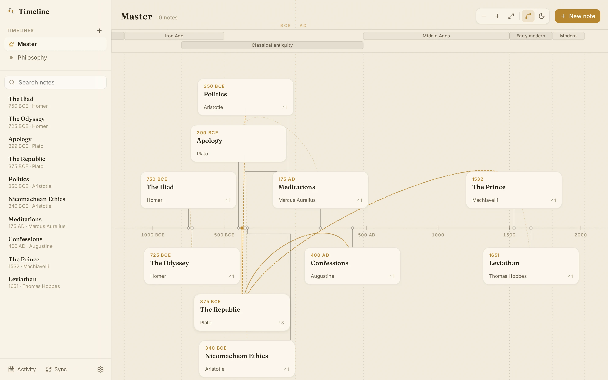
</p>

## What is this

As I read books, especially older ones, I wanted a way to plot them on a timeline and see how they relate to or differ from one another. Think of how Obsidian works, with its spider web graph of notes and links, but laid out on a timeline instead.

* Every note has a date, and every note lives on the timeline
* Notes link to each other with `[[Title]]`, just like Obsidian
* You can drag cards anywhere and they stay where you put them
* It works offline, and syncs between your devices through a private GitHub repo you own

If you've enjoyed using this tool, please star this repo!

## Download

Grab the latest release here: **[Releases](https://github.com/1sun12/timeline-app/releases/latest)**

| OS | File |
|---|---|
| Mac (Apple Silicon and Intel) | `Timeline_0.1.1_universal.dmg` |
| Windows 10 / 11 | `Timeline_0.1.1_x64-setup.exe` (or the `.msi`) |
| Linux | `Timeline_0.1.1_amd64.AppImage`, `.deb` or `.rpm` |

## Installing

1. Go here: **[Timeline v0.1.1 release](https://github.com/1sun12/timeline-app/releases/tag/v0.1.1)** and download the file for your OS (see [Download](#download))

The app isn't signed with a paid Apple or Microsoft certificate, so your OS will warn you the first time. That's expected; here's how to get past it on each one.

### Mac

1. Open the `.dmg` and drag **Timeline** into **Applications**
2. Open Timeline. macOS will say it can't verify the developer
3. Go to **System Settings → Privacy & Security**, scroll down and click **Open Anyway**
4. If macOS says the app "is damaged and can't be opened", run this once in Terminal, then open it again:

```bash
xattr -cr /Applications/Timeline.app
```

### Windows

1. Run `Timeline_0.1.1_x64-setup.exe`
2. If you get **"Windows protected your PC"** (SmartScreen), click **More info → Run anyway**
3. Timeline shows up in the Start menu when it's done

* Windows 10 and 11 already have WebView2, which the app needs. If yours doesn't, the installer downloads it
* The `.msi` does the same thing, it's just easier to deploy if you manage machines

### Linux

AppImage (works on most distros, nothing to install):

```bash
chmod +x Timeline_0.1.1_amd64.AppImage
./Timeline_0.1.1_amd64.AppImage
```

* If it won't start on Ubuntu 22.04 or newer, it needs FUSE 2: `sudo apt install libfuse2` (on 24.04 the package is `libfuse2t64`)

Debian / Ubuntu / Pop!_OS:

```bash
sudo apt install ./Timeline_0.1.1_amd64.deb
```

Fedora / RHEL:

```bash
sudo dnf install ./Timeline-0.1.1-1.x86_64.rpm
```

### Blocked by a firewall or antivirus?

* Timeline never opens a port or listens on the network, so it shouldn't need any inbound firewall rule. If one asks, you can deny it
* The only thing that goes online is **sync**, which uses `git` to reach GitHub over HTTPS (port 443) or SSH (port 22)
* If your network blocks port 22 (common on work and school networks), use the HTTPS link for your sync repo instead of the `git@github.com:` one, or route SSH over port 443 by adding this to `~/.ssh/config`:

```
Host github.com
  HostName ssh.github.com
  Port 443
```

* If antivirus quarantines the installer, restore it and add an exception. It's flagged only because it's unsigned; the source is all here

## How to use it

### The timeline

* Scroll the mouse wheel to zoom in and out (it zooms around your cursor). Pinch works on a trackpad
* Left-click and drag on an empty space to move around
* Press `0` to fit every note on screen
* The time range is basically unlimited: zoom from hours all the way out past the Big Bang

### Adding a note

* Click **New note**, press `Ctrl+N` (`Cmd+N` on Mac), or double-click anywhere on the line to add a note at that date
* A **year is required**. For older works, just estimate it. Use the **AD / BCE** toggle for the era
* Month, day and time are optional
* There's no year 0; 1 BCE is directly followed by 1 AD, same as the real calendar

### The side panel and links

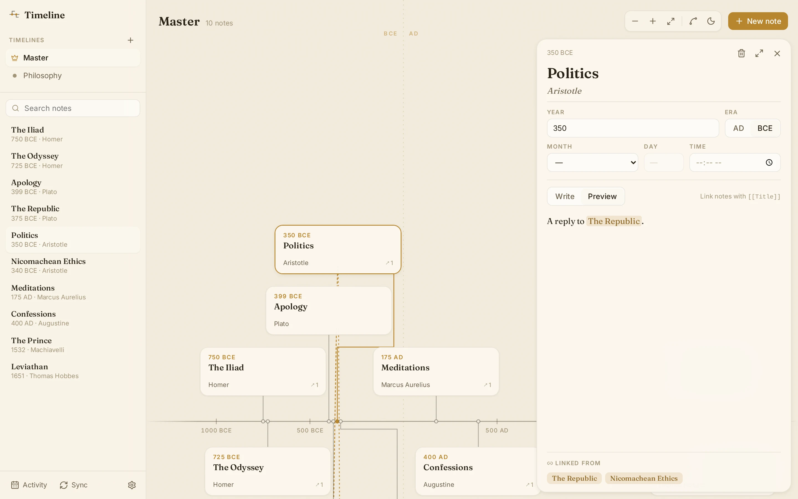

* Click a card to open it in the side panel
* Write in Markdown. Link to another note with `[[Its Title]]`
* Clicking a link in the side panel moves the timeline to that card and highlights it, but keeps your current note open
* Clicking a link to a note that doesn't exist yet creates it
* **Linked from** at the bottom shows every note that links to this one
* The curve button in the toolbar shows every link at once

### Full document view

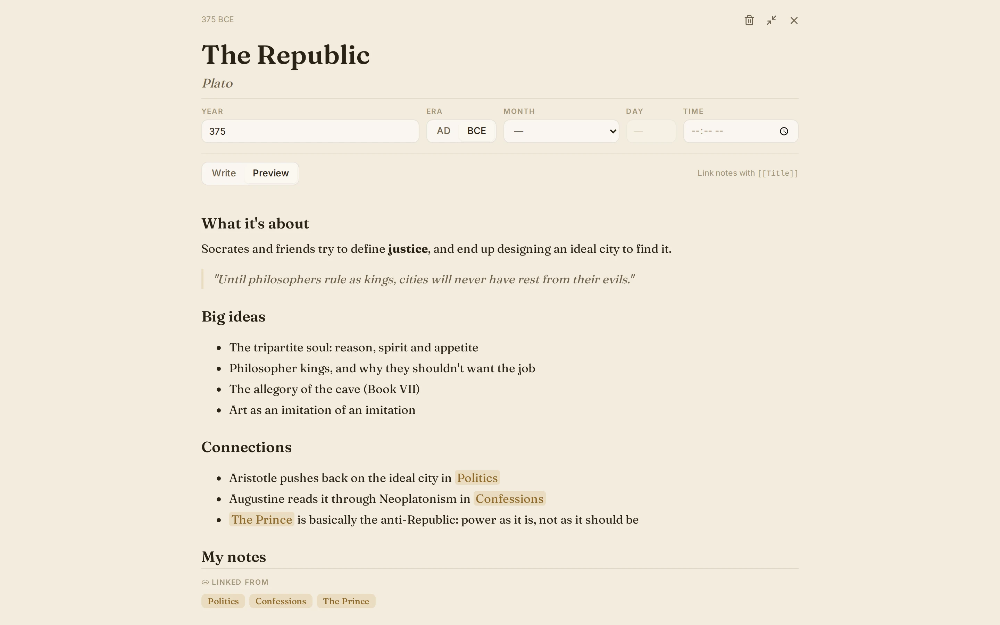

* Click the expand button in the side panel, press `Ctrl+Shift+F`, or double-click a card
* Same Write / Preview editor as the side panel, just with room to actually read and write
* Clicking a link in here takes you to that document
* `Esc` takes you back to the timeline

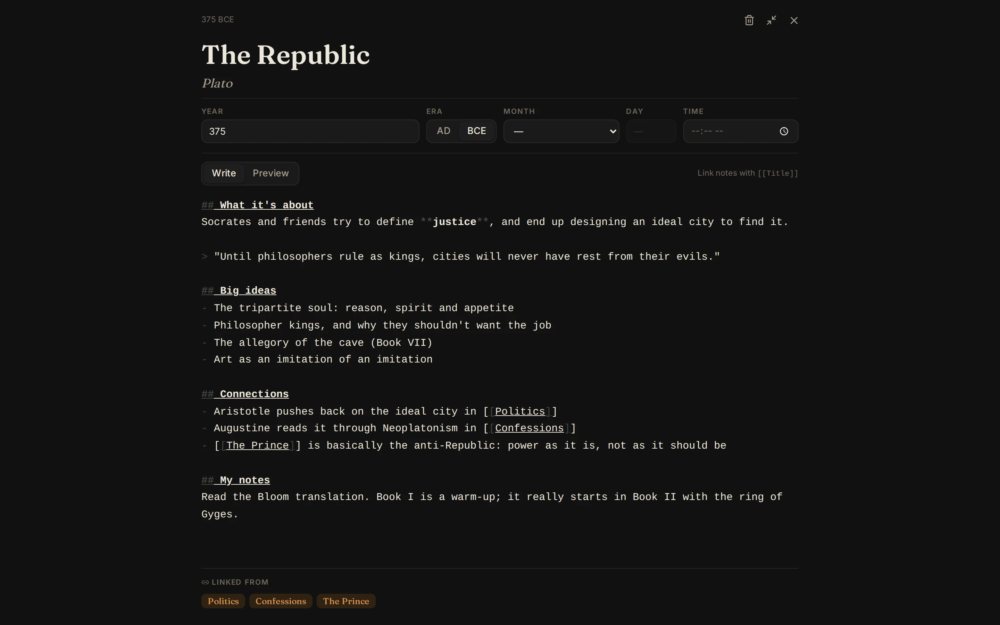

### Dragging and pinning cards

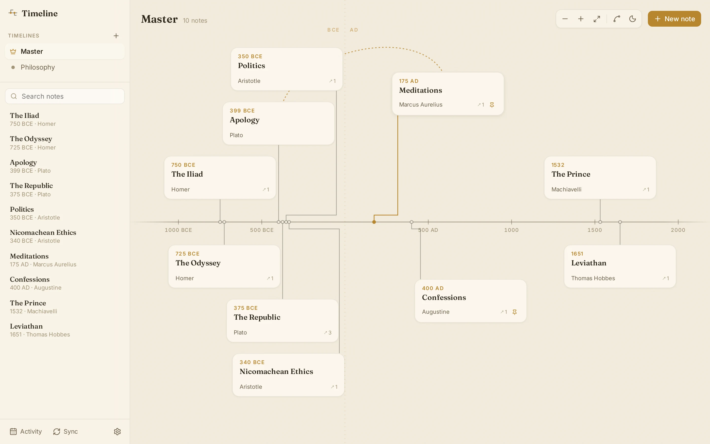

* Drag a card anywhere. Wherever you let go is where it stays, even after restarting
* A pin icon shows on cards you've placed. Click it to let the app place that card automatically again
* Every card has a stem back to its exact date. Stems only use right angles, and they're routed so they don't cross each other

### Era markers

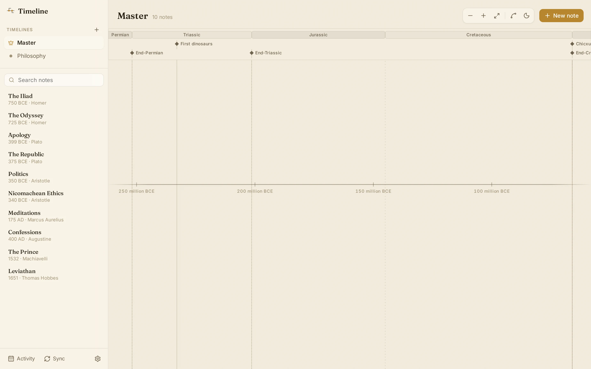

* The BCE / AD divide is always marked
* Turn on extra markers in **Settings → Timeline markers**:
  * Cosmic history (Big Bang, the Solar System and Earth forming, first life)
  * Geologic time (eons and periods, from the 2023 International Chronostratigraphic Chart)
  * Age of dinosaurs
  * Mass extinctions
  * Human prehistory
  * Historical ages (Bronze Age through Modern)
* Hover any marker for its full name

### Activity

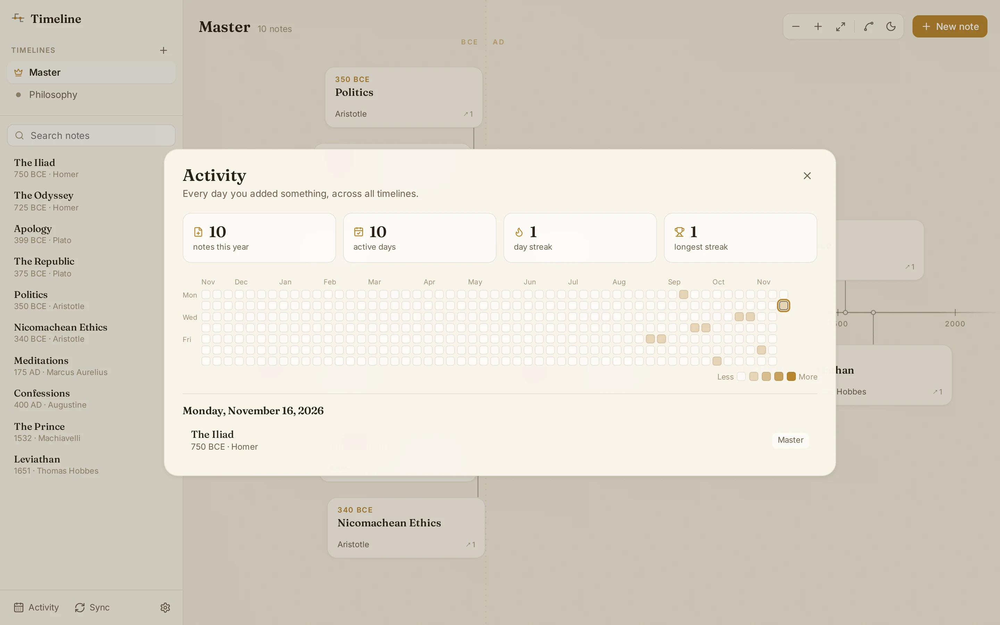

* A GitHub style heat map of every day you added something, across all your timelines
* Shows your current streak and longest streak
* Click a day to see what you added, and click a note to jump to it

### Timelines

* There's always a **Master** timeline, and it can't be deleted
* Make as many others as you want with the **+** next to Timelines, i.e. one for books, one for research papers, one for homework
* Double-click a timeline to rename it. Hover it for the delete button

### Settings

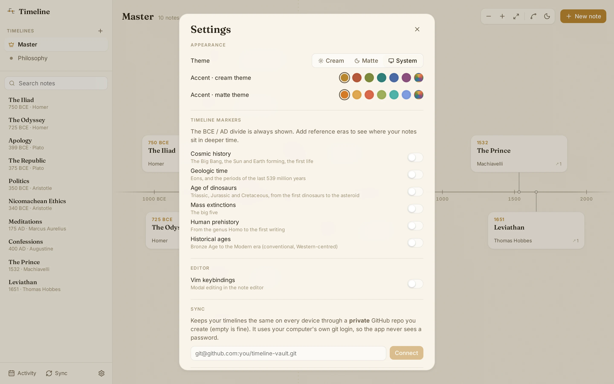

* **Theme**: Cream, Matte (black) or follow your system
* **Accent color**: pick one for each theme, or a custom color
* **Vim keybindings** for the editor, on or off
* **Sync** and **Share** (below)

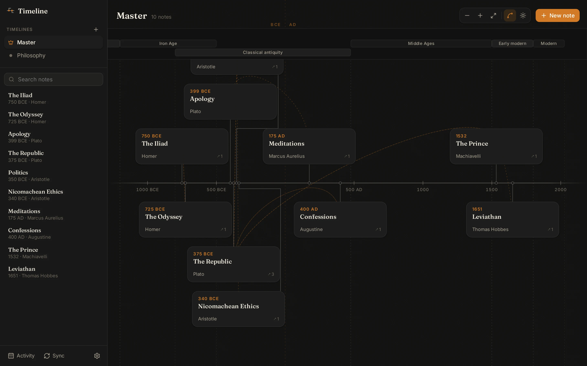

### Sharing a timeline

* **Settings → Share → Export** saves the current timeline as a `.json` file you can send to anyone
* **Import timeline** adds a file like that as a new timeline. It never overwrites anything you already have
* Links and card positions come along with it

### Syncing between devices

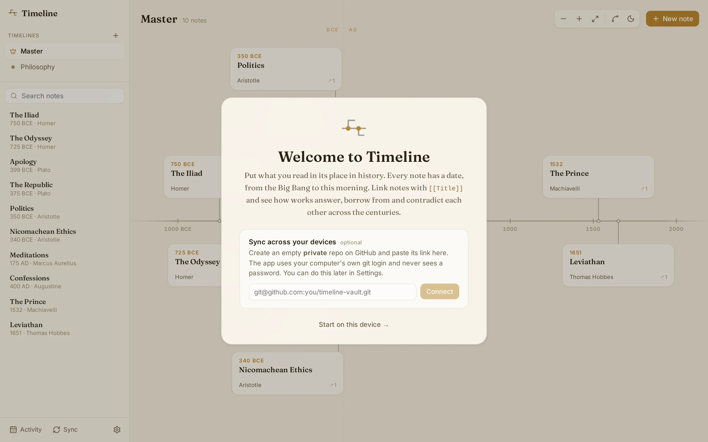

1. Create an **empty, private** repo on GitHub, i.e. `timeline-vault`
2. Paste its link on the welcome screen, or later in **Settings → Sync**
3. Do the same on your other devices with the same link

* It uses your computer's own `git` login (SSH key or credential manager), so the app never sees or stores a password
* You need `git` installed:
  * Mac: `xcode-select --install`
  * Windows: [Git for Windows](https://git-scm.com/download/win)
  * Linux: `sudo apt install git` (or your distro's equivalent)
* It syncs when the app opens, about a minute after you make changes, every 5 minutes, and whenever you click **Sync**

## Keyboard shortcuts

* `Ctrl+N` new note
* `Ctrl+F` search notes
* `Ctrl+Shift+F` full document view on / off
* `Ctrl+,` settings
* `Esc` close (leaves the full view first)
* `+` / `-` zoom, `0` fit everything

On a Mac, use `Cmd` instead of `Ctrl`.

## FAQ

**Where is my data stored?**

* Mac: `~/Library/Application Support/com.timeline-app.dev/`
* Windows: `%APPDATA%\com.timeline-app.dev\`
* Linux: `~/.local/share/com.timeline-app.dev/`
* It's a single SQLite file, `timeline.db`. Back that up and you've backed up everything

**Do I need the internet?**

* No. Everything works offline. Only sync goes online

**What happens if I edit the same note on two devices?**

* The newer edit wins, and the other one is kept as a "(conflict copy)" note so nothing is lost

**I deleted a note on one device and it came back.**

* That happens if it was edited on another device after you deleted it. On purpose: getting rid of an unwanted note is one click, getting back a lost one is impossible

**Why GitHub for sync instead of an account?**

* No server to run, no account to make, free, private, and you get the full history of your notes as a bonus

**How far back can a date go?**

* A trillion years in either direction. The Big Bang is about 13.8 billion BCE, so you're covered

**Can I put a card back where the app wants it?**

* Click the pin icon on the card

**Does the theme sync?**

* No. Theme, accent colors, Vim mode and the sync link are per device. Notes, timelines and card positions sync

## Building from source

You'll need [Node.js](https://nodejs.org) 22+, [Rust](https://rustup.rs), and the [Tauri prerequisites](https://tauri.app/start/prerequisites/) for your OS.

```bash
git clone https://github.com/1sun12/timeline-app.git
cd timeline-app
npm install
npm run tauri dev
```

* `npm run tauri build` makes the installers for whatever OS you're on
* `npm run dev` runs just the UI in a browser with sample data, handy for design work
* Pushing a `v*` tag builds Mac, Windows and Linux in GitHub Actions and drafts a release

Tests:

```bash
npm test                      # date math and stem routing
npm run check                 # type check
cd src-tauri && cargo test    # database, sync and sharing
npm run test:ui               # UI tests (run `npm run dev` first)
```

## Tech stack

* Made with [Tauri 2](https://tauri.app), so it's a small native app on Mac, Windows and Linux instead of a bundled browser
* Rust backend, with [SQLite](https://sqlite.org) (through `rusqlite`) for storage
* Sync is plain `git`, with a three-way merge per note so git never has to merge text
* [Svelte 5](https://svelte.dev) and TypeScript front end, through SvelteKit
* [CodeMirror 6](https://codemirror.net) for the editor, with [codemirror-vim](https://github.com/replit/codemirror-vim) for Vim mode
* [marked](https://marked.js.org) for Markdown and [DOMPurify](https://github.com/cure53/DOMPurify) to keep shared notes safe
* Inter and Fraunces fonts, and [Lucide](https://lucide.dev) icons
* Built and released with GitHub Actions

## License

MIT, see [LICENSE](LICENSE).

If you've enjoyed using this tool, please star this repo!
